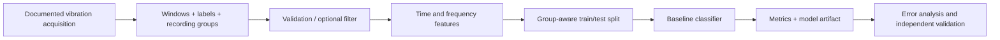

# ⚙️ Motor Fault Detection
### Vibration Signal Processing · Condition Monitoring · Reproducible Machine Learning

<div align="center">

[](https://www.python.org/)
[](https://numpy.org/)
[](https://scipy.org/)
[](https://scikit-learn.org/)
[](https://github.com/shivtejsalunke/Motor-Fault-Detection/actions/workflows/python-tests.yml)
[](LICENSE)

**An auditable engineering baseline for vibration-based rotating-machine condition monitoring.**

</div>

---

## At a glance

This project builds a reproducible path from fixed-window vibration signals to interpretable time/frequency features and baseline classifiers. It is designed for engineers working across digital signal processing, machinery diagnostics, and edge-ML prototyping.

> **Evidence boundary:** no verified real-machine dataset is bundled or claimed as acquired. The automated tests and smoke demo use synthetic signals to validate code behavior only. This repository does **not** claim real-world accuracy, validated fault coverage, or production predictive-maintenance readiness.

## Engineering scope

| Layer | Implemented | Engineering value |
|---|---|---|
| Input contracts | Shape, finite-value and sampling-rate checks; window segmentation | Rejects ambiguous or malformed measurements early |
| Signal processing | Optional Butterworth band-pass; DC removal/normalization helpers | Validates the Nyquist boundary and consistent preprocessing |
| Spectral analysis | `rfft`, `rfftfreq`, Hann-windowed amplitude spectrum | Frequency features are expressed in **Hz** using an explicit sample rate |
| Features | RMS, peak-to-peak, crest factor, excess kurtosis, skewness, dominant frequency, spectral centroid | Interpretable signals for feature review and ablation |
| Baselines | Random Forest and Logistic Regression | Nonlinear baseline plus a scaled linear comparator |
| Evaluation | Group-aware holdout, accuracy, macro precision/recall/F1, confusion matrix and per-class report | Keeps the same recording/session/machine group out of both partitions |
| Artifacts | Serialized estimator and JSON metrics | Reproducible runs with inspectable outputs |
| Quality | Unit tests and GitHub Actions | Fast regression checks on code changes |

## Signal-to-model flow



## Repository layout

```text
src/motor_fault_detection/
  data_loader.py       # Signal validation, CSV loading and windowing
  preprocessing.py     # DC removal and normalization
  filtering.py         # Butterworth band-pass with Nyquist validation
  fft_analysis.py      # Frequency axis and amplitude spectrum
  features.py          # Interpretable time/frequency features
  train.py             # Group-aware model training and metrics
  evaluate.py          # Evaluation on separately held-out windows
  predict.py            # Single-window inference
configs/                # Example experiment settings
scripts/                # Synthetic fixture and command-line helpers
tests/                  # Unit and pipeline tests
docs/                   # Dataset card, evaluation protocol, DSP notes
reports/                # Explicit model-evidence status
```

## Quick start

Requires Python 3.10 or newer.

```bash
git clone https://github.com/shivtejsalunke/Motor-Fault-Detection.git
cd Motor-Fault-Detection
python -m venv .venv
# Linux/macOS
source .venv/bin/activate
# Windows PowerShell: .venv\Scripts\Activate.ps1
python -m pip install --upgrade pip
python -m pip install -e '.[test]'
make test
```

The authored suite contains six tests. Passing tests establish software behavior, not performance on physical machines.

### End-to-end synthetic smoke test

```bash
make synthetic-demo
```

This builds artificial sine-wave windows with synthetic group identifiers, then runs training. Its metrics are **not** machine-fault accuracy and must not be presented as real-world evidence.

## Real dataset contract

No real dataset is included. Review [data/README.md](data/README.md), the [dataset card](docs/dataset-card.md), and the [evaluation protocol](docs/evaluation-protocol.md) before modeling.

Training expects an NPZ file containing:
- `windows`: numeric array of shape `(n_windows, n_samples_per_window)`;
- `labels`: one class label per window;
- `groups`: recording, session, or machine ID aligned with every label.

The sample rate in Hz, sensor units, calibration, axis/mounting, operating speed/load, label provenance, acquisition settings, and dataset license must be sourced from measurement documentation—not guessed from the data shape.

```bash
PYTHONPATH=src python -m motor_fault_detection.train \
  /path/to/verified_dataset.npz \
  --sampling-rate 12000 \
  --model random_forest \
  --seed 17 \
  --out results/experiment-001
```

The rate above is illustrative; substitute the documented rate of the dataset. Outputs include `model.joblib` and `metrics.json`. Inspect the training and test group IDs before interpreting metrics. Small datasets can result in partitions missing classes; improve the group split or dataset coverage rather than switching to random window splitting.

Evaluate a model against a separate NPZ with `windows` and `labels`:
```bash
PYTHONPATH=src python -m motor_fault_detection.evaluate \
  results/experiment-001/model.joblib \
  /path/to/independent_test_windows.npz \
  --sampling-rate 12000 \
  --out results/experiment-001/independent-evaluation.json
```

## Evaluation discipline

Overlapping or adjacent windows from one trace are correlated. Therefore, the holdout is performed on provided `groups` rather than individual windows. A defensible external evaluation should add grouped cross-validation, confidence intervals, class-imbalance analysis, speed/load stratification, feature ablations, and an untouched machine/session.

Before making a performance claim, record:
1. **Provenance:** source, license/terms, citation, retrieval date and dataset checksum.
2. **Measurement chain:** sensor, mounting, units, calibration, sample rate and anti-aliasing.
3. **Operating envelope:** machine, RPM/load, acquisition session, fault severity and label method.
4. **Split integrity:** group definition, group IDs, duplicate checks and temporal-leakage controls.
5. **Metrics:** per-class recall/precision, confusion matrix, support, uncertainty and false-negative implications.
6. **Reproducibility:** package versions, seed, config, source revision, model and JSON results.

## Status and roadmap

- ✅ Input validation, segmentation, optional filtering, feature extraction and two baseline models.
- ✅ Group-aware holdout and structured evaluation metrics.
- ✅ CLI training, evaluation and single-window inference.
- ✅ Synthetic software fixture and regression tests.
- ⏳ Real-dataset provenance review and evaluation.
- ⏳ Grouped cross-validation, uncertainty estimates, drift analysis and edge-device benchmarks.
- ⏳ No sensor calibration, real-time acquisition, machine integration, or deployment qualification is claimed.

Planned next steps: license and document a public vibration dataset; add repeated grouped validation and confidence intervals; benchmark ablations/operating-condition sensitivity; and profile inference on a named target. Details in [docs/](docs/) and [reports/model-evaluation.md](reports/model-evaluation.md).

## Audience

Built for signal-processing engineers, condition-monitoring researchers, embedded/edge-ML engineers and reviewers who value explicit units, dataset lineage, leakage-aware testing and inspectable artifacts.

## License

Original project code is MIT-licensed. External datasets and third-party material remain subject to their own terms and attribution requirements.

---

<div align="center"><b>Traceable data → interpretable features → leakage-aware evaluation.</b></div>
